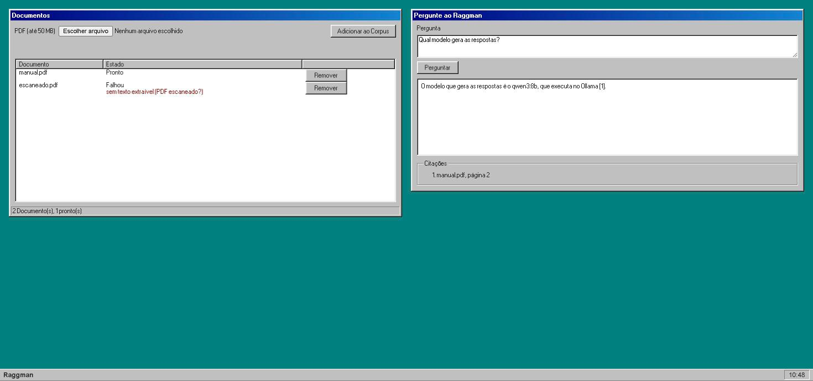

# Raggman

RAG plug-and-play, 100% local: você sobe com um comando, envia seus PDFs e faz perguntas. As Respostas vêm **só** do que está nos seus Documentos, com Citações apontando a página de onde cada informação saiu.



- **Local por padrão:** embeddings e geração rodam no [Ollama](https://ollama.com), sem enviar nada para a nuvem. Se você tiver uma API key, pode usar um provedor compatível com a API da OpenAI só para gerar Respostas (os embeddings continuam locais).
- **Respostas citadas:** cada afirmação traz um marcador `[n]`, e a Resposta termina com a lista de Citações (Documento e página). Se nada no Corpus for relevante, o Raggman diz que não encontrou, sem chamar o modelo.
- **Resposta em streaming** via Server-Sent Events, no idioma da Pergunta, mesmo que o PDF esteja em outro idioma. A única exceção é o "não encontrado", uma frase fixa em inglês na API; a interface a traduz.
- **Interface retrô** no estilo Windows 98 ([98.css](https://github.com/jdan/98.css)), servida pelo próprio binário Go, sem build de frontend.
- **Rastreável de ponta a ponta:** OpenTelemetry + Jaeger. O envio de um PDF e a Ingestion que ele dispara aparecem no mesmo trace, e cada linha de log carrega o `trace_id`.

## Início rápido

Requisito: Docker com pelo menos 8 GB de memória disponível para os containers.

```sh
git clone https://github.com/if-tux/raggman.git
cd raggman
docker compose up -d --build --wait
```

Abra **http://localhost:8080**, envie um PDF e faça uma Pergunta.

No primeiro `up`, o serviço `ollama-init` baixa os modelos (cerca de 6 GB: `qwen3:8b` para as Respostas e `qwen3-embedding:0.6b` para os embeddings). Acompanhe com `docker compose logs -f ollama-init`. Nas próximas vezes, o `up` leva segundos.

Para parar: `docker compose down`. Para apagar também os dados e os modelos baixados: `docker compose down -v`.

### macOS: use o Ollama do host para ter GPU

O Docker no macOS não acessa a GPU, então dentro do container o modelo roda só em CPU. Num MacBook com 16 GB, a Resposta a uma Pergunta curta levou de 13 a 24s no container, contra cerca de 11s com GPU. Com o [Ollama](https://ollama.com/download) instalado e rodando no Mac (`ollama serve`), aponte o Raggman para ele:

```sh
RAGGMAN_OLLAMA_HOST=http://host.docker.internal:11434 \
LLM_BASE_URL=http://host.docker.internal:11434/v1 \
docker compose up -d --build --wait
```

Assim o `ollama-init` baixa os modelos direto no Ollama do Mac (ou nem baixa, se eles já estiverem lá). Num MacBook com 16 GB, um PDF pequeno fica pronto em cerca de 1s, e a Resposta completa leva cerca de 11s.

Essas variáveis valem só para esse `up`: um `docker compose up` sem elas volta a usar o Ollama do container. Para não repetir, salve as duas linhas num arquivo `mac.env` e use `docker compose --env-file mac.env up -d --build --wait`.

### Linux com GPU NVIDIA

Com o [NVIDIA Container Toolkit](https://docs.nvidia.com/datacenter/cloud-native/container-toolkit/) instalado:

```sh
docker compose -f docker-compose.yml -f docker-compose.gpu.yml up -d --build --wait
```

### Usando uma API key (opcional)

Para gerar as Respostas num provedor compatível com a API da OpenAI (OpenAI, OpenRouter, Groq…):

```sh
LLM_BASE_URL=https://api.openai.com/v1 \
LLM_API_KEY=sk-... \
LLM_MODEL=gpt-4o-mini \
docker compose up -d --build --wait
```

Com `LLM_API_KEY` definida, o `ollama-init` não baixa o modelo de chat. Os embeddings **sempre** continuam no Ollama local ([ADR-0004](docs/adr/0004-local-by-default.md)): o Corpus nunca depende de um provedor pago, e o texto dos seus PDFs só sai da máquina nos Chunks enviados junto com cada Pergunta.

## Usando a API

A interface usa a mesma API HTTP, que você pode chamar direto:

```sh
# Enviar um PDF (201 se for novo; 200 se o mesmo conteúdo já tiver sido enviado)
curl -F file=@relatorio.pdf http://localhost:8080/documents

# Listar Documentos e ver o estado de um deles
curl http://localhost:8080/documents
curl http://localhost:8080/documents/<id>

# Perguntar (a Resposta chega em streaming)
curl -N http://localhost:8080/questions \
  -H 'Content-Type: application/json' \
  -d '{"question": "Qual é o prazo de entrega?"}'

# Remover um Documento e seus Chunks
curl -X DELETE http://localhost:8080/documents/<id>
```

| Método | Rota | O que faz |
|---|---|---|
| `POST` | `/documents` | Envia um PDF (multipart, campo `file`, até 50 MB). Conteúdo idêntico devolve o Documento existente; reenviar um Documento `FAILED` reinicia a Ingestion. |
| `GET` | `/documents` | Lista os Documentos com seus estados. |
| `GET` | `/documents/{id}` | Estado e, se falhou, o motivo. |
| `DELETE` | `/documents/{id}` | Remove o Documento, o PDF e os Chunks. |
| `POST` | `/questions` | `{"question": "..."}` → Server-Sent Events, descritos abaixo. |
| `GET` | `/healthz` | `200` quando a app e o banco estão de pé. |

Eventos de `/questions`, nesta ordem:
1. `thinking`, opcional: o modelo está raciocinando antes de responder.
2. `token`: um ou mais, com `{"text": "..."}` contendo pedaços da Resposta.
3. `citations`: `{"citations": [{"marker", "filename", "page", "chunk_id", "document_id"}]}`, só com as Citações que a Resposta realmente usou.

Se a geração falhar no meio, um evento `error` vem no lugar de `citations`. Se falhar antes do primeiro evento, a resposta é HTTP `502`.

Estados de um Documento: `PENDING` → `INGESTING` → `READY` (entra no Corpus) ou `FAILED` (com motivo). A Ingestion é tentada até 3 vezes, com 10s e depois 40s de espera entre as tentativas.

## Configuração

Tudo é configurado por variáveis de ambiente. Os padrões abaixo são os do `docker compose`; rodando com `make dev`, os endereços padrão apontam para `localhost`.

| Variável | Padrão | Para quê |
|---|---|---|
| `LLM_BASE_URL` | `http://ollama:11434/v1` | Endpoint compatível com OpenAI que gera as Respostas. |
| `LLM_API_KEY` | vazio | API key do provedor. Vazio significa Ollama local. |
| `LLM_MODEL` | `qwen3:8b` | Modelo de chat. |
| `LLM_THINKING` | `true` | Deixa modelos locais "pensarem" antes de responder: o primeiro token demora mais, mas o modelo inventa muito menos. Só vale para o Ollama local. |
| `RAGGMAN_OLLAMA_HOST` | `http://ollama:11434` | Ollama usado para os embeddings (sempre local). Dentro da app, ele vira `OLLAMA_HOST`; com `make dev`, use `OLLAMA_HOST` direto. |
| `TOP_K` | `5` | Quantos Chunks são buscados por Pergunta. |
| `MIN_SIMILARITY` | `0.3` | Similaridade mínima para um Chunk contar. Abaixo disso, a Resposta é "não encontrado". |
| `RAGGMAN_PORT` | `8080` | Porta da interface e da API no host. |
| `POSTGRES_PORT` | `5432` | Porta do Postgres no host. Mude se a 5432 já estiver em uso; para o `make dev`, ajuste também o `DATABASE_URL` no `.env`. |
| `OTEL_TRACES_EXPORTER` | `otlp` | `none` desliga o envio de traces. |
| `LOG_LEVEL` | `INFO` | `DEBUG`, `INFO`, `WARN` ou `ERROR`. |

O modelo de embedding (`qwen3-embedding:0.6b`, 1024 dimensões) é fixo de propósito: misturar modelos quebraria a busca, e trocar de modelo exige reingerir tudo ([ADR-0001](docs/adr/0001-single-dedicated-embedding-model.md)).

## Como funciona

```text
PDF ─▶ POST /documents ──┬─▶ documents + PDF + Job, numa única transação no Postgres
                         │
        workers (no mesmo processo) puxam o Job da fila no Postgres (FOR UPDATE SKIP LOCKED)
                         │
                         ├─ pdftotext, página por página
                         ├─ Chunks de ~2000 caracteres, sem cruzar páginas
                         ├─ embeddings no Ollama (qwen3-embedding, 1024 dims)
                         └─ Chunks + índice HNSW (pgvector) ─▶ Documento READY

Pergunta ─▶ POST /questions
              ├─ embedding da Pergunta
              ├─ busca dos Chunks mais próximos, só de Documentos READY
              ├─ nada acima de MIN_SIMILARITY? ─▶ "não encontrado", sem chamar o modelo
              └─ qwen3:8b responde só com base nesses Chunks, citando [n] ─▶ SSE
```

- **Fila no próprio Postgres, sem RabbitMQ** ([ADR-0003](docs/adr/0003-postgres-as-job-queue.md)): o Documento e o Job nascem na mesma transação, e o gargalo é o modelo, não a fila.
- **Chunks nunca cruzam páginas** ([ADR-0002](docs/adr/0002-chunks-never-span-pages.md)), então cada Citação aponta uma página exata.
- **Resiliência:** retry com backoff, motivo de falha legível, heartbeat e lock por worker, e graceful shutdown que devolve à fila os Jobs não terminados.

## Observabilidade

O Jaeger fica em **http://localhost:16686** (serviço `raggman`). Um envio aparece assim:

```text
POST /documents → ingestion → ingestion.extract · ingestion.chunk · ingestion.embed · ingestion.store
POST /questions → answering.embed · answering.retrieve · answering.generate
```

Os logs saem em JSON no container, com `trace_id` e `span_id` em cada linha emitida dentro de um trace: `docker compose logs -f app`.

## Desenvolvimento

Requisitos: Go 1.26+, Docker, `pdftotext` (`brew install poppler`), e, para gerar código, [`sqlc`](https://sqlc.dev) e [`wire`](https://github.com/google/wire).

```sh
cp .env.example .env
make infra-up     # Postgres e Jaeger no Docker
make ollama-start # Ollama no host com os dois modelos
make dev          # roda a app em localhost:8080 (migrations rodam sozinhas)
make test         # testes (precisam do Docker, para o testcontainers)
make smoke        # ponta a ponta contra um Raggman rodando, com os modelos reais (usa RAGGMAN_PORT do ambiente)
make sqlc         # regenera as queries depois de mudar internal/infra/postgres/queries
make wire         # regenera a injeção de dependências depois de mudar cmd/api/wire.go
```

Os testes passam pela API HTTP com um Postgres real ([testcontainers](https://golang.testcontainers.org)) e um servidor falso compatível com a OpenAI, que deixa as respostas determinísticas. O `make smoke` fica fora do CI porque a saída de um modelo real não é determinística.

```text
cmd/api            main, injeção de dependências, testes da API
cmd/smoke          verificação ponta a ponta com modelos reais
internal/domain    regras do negócio: ciclo de vida do Documento, chunking, Citações
internal/documents envio, listagem e remoção de Documentos
internal/ingestion workers da Ingestion
internal/answering busca e geração da Resposta
internal/api       rotas HTTP e SSE
internal/web       interface (HTML, CSS, JS e 98.css embutidos)
internal/infra     Postgres, sqlc, cliente LLM, pdftotext, logs, telemetria
```

O vocabulário do projeto (Corpus, Document, Chunk, Ingestion, Question, Answer, Citation…) está no [GLOSSARY.md](GLOSSARY.md). As decisões de arquitetura estão em [docs/adr](docs/adr).

## Limitações conhecidas

- **Sem autenticação:** o Raggman foi feito para rodar na sua máquina. Não o exponha na internet.
- **Só PDF com texto selecionável:** sem OCR. Um PDF escaneado falha com "sem texto extraível".
- **Primeira Resposta lenta:** com o thinking ligado, o primeiro token levou de 7 a 14s nas medições num Mac com 16 GB (Ollama do host). Com `LLM_THINKING=false` saiu em menos de 1s, mas o modelo chegou a inventar um fato com Citação numa pergunta-pegadinha.
- **Um único Corpus compartilhado,** sem usuários nem histórico de conversa: cada Pergunta é independente.

## Próximos passos

A v2 vai traduzir livros com níveis de tradução (formal, informal, infantil…). O maior desafio é traduzir sem que o modelo local alucine.
